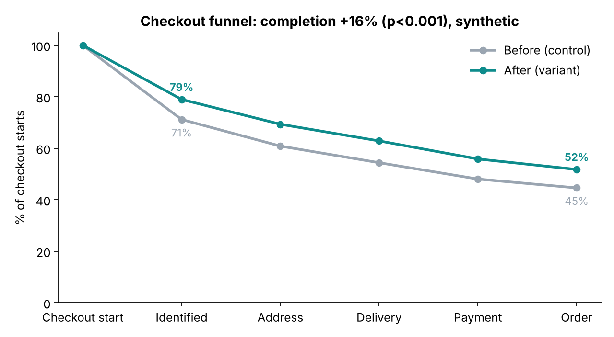
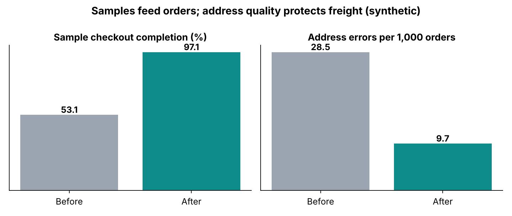

# Checkout revamp (CRO): clickable prototype + funnel analysis

### ▶ [Try the live prototype](https://amr-nerdie1.github.io/checkout-cro/)
Switch between **Before** and **After**, order a free sample, then check out the flooring. The counter shows clicks, fields typed and time.

A reconstruction, using a **fictional store and synthetic data**, of a cart and checkout revamp I led as Senior PM at an online building-materials marketplace. It rolled out in phases to **3M+ monthly users** and delivered **+15% revenue**.

## The product-sense version

**Goal.** Grow revenue from existing traffic, since acquisition was expensive. Checkout is where intent is highest.

**Who buys, and why.** The core buyer is a first-time DIY homeowner, mostly on mobile, making an intimidating, high-ticket purchase ($3–4K). They order **samples first**, and samples are the leading indicator of orders. Pros are repeat buyers who want speed.

**What was broken**

| Pain | Evidence | Cost |
|---|---|---|
| A free sample went through the full freight checkout, including **live shipping-rate calls** | Funnel drop-off on the sample path | Fewer samples, so fewer future orders |
| **Account wall** before checkout | Biggest single drop in the funnel | Lost first-time buyers |
| No **address autocomplete**, no confirmation | Support tickets, failed deliveries | Redelivery fees and returns on freight |
| **Assigned delivery date** for LTL freight | Missed deliveries, reschedule calls | Ops cost, unhappy customers |

**What shipped (prioritised by impact vs effort, sample path first)**

1. **One-click sample checkout.** Samples skip the rate-service calls and cost allocation used for freight.
2. **Guest-first check-in.** Enter an email. If it isn't recognised, continue as a guest; the account is offered *after* the order.
3. **Address autocomplete + review step.** Google Places in production, plus a "ship here?" confirmation before payment.
4. **Customer-chosen delivery dates** from real LTL windows.
5. **Payments rebuilt around third-party processors**, piloted and phased in with A/B guardrails.

> Not all friction is bad. The address review step *adds* a click on purpose, because a wrong address on a freight order costs far more than one click. The goal was fewer fields typed and fewer dead ends, not the fewest possible clicks.

**Metrics.** North star: checkout completion → revenue. Inputs: sample checkout completion, guest-to-account activation, delivery-date selection. Guardrails: payment failures, fraud rate, address errors / failed deliveries.

## Prototype: what to try

| Path | Before | After |
|---|---|---|
| Free sample | Account form → address form → live rate wait → payment | **One click** (saved address) |
| New customer | 5-field account wall | Email → "continue as guest" → activate at the end |
| Address | 4 blank fields | Autocomplete (try "118", "224", "Cedar") + review step |
| Delivery | Assigned date after a rate-lookup spinner | Pick from 10 delivery days |

On the sample path the prototype goes from **6 clicks and 9 typed fields** to **2 clicks and 0 fields**.

## Analysis (synthetic): how the revamp was read

`analysis/funnel_ab.py` simulates control vs variant sessions and runs the read-out used for the real launch: stage-by-stage funnel, two-proportion z-tests with 95% CIs, the sample funnel on its own, and an address-error guardrail.

```
Checkout completion: control 44.6%  variant 51.8%  lift +16.0%  p=<0.001  95% CI of diff [+6.18%, +8.13%]
  Identified   71.2% -> 79.0%     <- guest-first removes the account wall
  Address      85.5% -> 87.8%     <- autocomplete
  Delivery     89.4% -> 90.7%     <- chosen dates
Sample orders: control 53.1%  variant 97.1%
Address errors per 1,000 orders: control 28.5  variant 9.7
```




*Synthetic data, tuned to be realistic. The production result I cite is +15% revenue.*

## Run it
Open `index.html` in a browser (no build step), or use the [live version](https://amr-nerdie1.github.io/checkout-cro/).

```bash
pip install -r requirements.txt
python analysis/funnel_ab.py
```

The prototype takes no payment details and stores nothing. "Plankhouse" and its products are fictional.

---
**Amrisha Rajkhowa** · Product & analytics leader · [LinkedIn](https://ca.linkedin.com/in/amrisha-rajkhowa-ubc) · more: [pro-self-serve-platform](https://github.com/amr-nerdie1/pro-self-serve-platform) · [sku-profitability-agent](https://github.com/amr-nerdie1/sku-profitability-agent) · [ltl-freight-auditor](https://github.com/amr-nerdie1/ltl-freight-auditor) · [bayesian-bid-pricing](https://github.com/amr-nerdie1/bayesian-bid-pricing)
